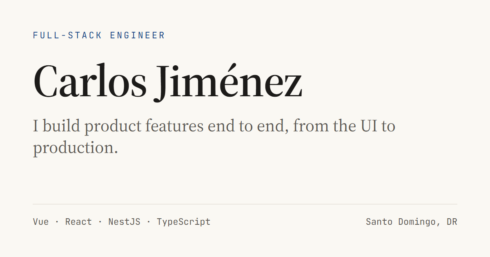

# portfolio

Personal site of **Carlos Jiménez**, full-stack engineer in Santo Domingo, Dominican Republic.

**Live:** https://portfolio-carlosj09.netlify.app



## What's here

- **`/`**: experience, projects, skills, education and about, on one page.
- **`/projects/vendor-vetting`**: case study of
  [vendor-vetting](https://github.com/CarlosJ09/vendor-vetting), an LLM pipeline that vets
  supplier documents. Every number on that page comes from the project's README or its
  `eval-results/`.

## Stack

[Astro](https://astro.build) 4 · TypeScript · Tailwind CSS 3 · self-hosted fonts via Fontsource
(Source Serif 4, JetBrains Mono). Static output, deployed on Netlify.

No client framework. The only scripts are the theme toggle and a couple of small
`astro:page-load` handlers.

## Running it

```bash
npm install
npm run dev       # http://localhost:4321
npm run build     # astro check + static build into dist/
npm run preview   # serve dist/
```

Changes to `tailwind.config.mjs` need a dev-server restart.

## Layout

```
src/
  layouts/Layout.astro         <head>, meta / Open Graph tags, theme tokens, theme bootstrap
  pages/index.astro            home page: section order lives here
  pages/projects/              case studies
  components/                  one component per section (Hero, Experience, Projects, …)
  consts.ts                    career start year, contact links
  assets/                      images optimized at build time by astro:assets
public/                        favicons, Open Graph images
```

### Design tokens

Colors are CSS variables (RGB channels) defined in `src/layouts/Layout.astro` for `:root` and
`:root.dark`, and exposed to Tailwind as `paper`, `ink`, `muted`, `rule` and `accent` in
`tailwind.config.mjs`. Change a color in one place and both themes follow.

The theme (light / dark / system) is applied by an inline script in `<head>` before first paint
and again after every view-transition swap.

### Content

Copy lives in the components as plain data (`EXPERIENCE` in `Experience.astro`, `FEATURED` and
`PROJECTS` in `Projects.astro`, `GROUPS` in `Skills.astro`). Years of experience are derived from
`CAREER_START_YEAR` in `src/consts.ts`, so they never go stale.

`CLAUDE.md` holds the brief and content rules for this site: what can and can't be claimed, which
names are allowed, and the positioning.

### Open Graph images

`public/og.png` and `public/og-vendor-vetting.png` are 1200×630 PNGs rendered from HTML with
headless Chrome using the site's own fonts and colors. A page picks its image with the `ogImage`
prop on `Layout`.

## License

MIT
